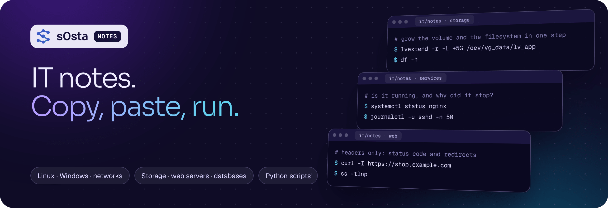

<a href="https://s0sta.com"></a>

# IT notes

Practical IT notes from my LinkedIn posts: Linux, Windows, networks, storage, web servers, databases and security. Every note has a **quick reference** you can copy, the **full explanation**, and the **script** when there is one.

| Notes | Topics | Scripts |
|:--|:--|:--|
| **117** | **11** | **17** Python scripts, standard library only |

Cloud, containers, Kubernetes, CI/CD and security automation are in **[DevSecOps-Notes](https://github.com/s0sta/DevSecOps-Notes)**. The 40 notes that fit both are in both repos.

## How to use it

1. Open a topic below and pick a note.
2. Copy a command from a code box. GitHub shows a copy button on every box.
3. Need a script? It is at the end of the note and in [`scripts/`](scripts).

Looking for one command? Use the search box at the top of GitHub, for example `lvextend` or `journalctl`.

## Notes by topic

<details>
<summary><b>Databases &amp; SQL</b> · 26 notes</summary>

- [Fix: MySQL Too many connections](notes/p121-fix-mysql-too-many-connections.md) <sub>P121</sub>
- [A zero-downtime database migration](notes/p168-a-zero-downtime-database-migration.md) <sub>P168</sub>
- [How a SQL query runs, drawn](notes/p322-how-a-sql-query-runs-drawn.md) <sub>P322</sub>
- [The four joins, drawn](notes/p323-the-four-joins-drawn.md) <sub>P323</sub>
- [The SQL cheat sheet](notes/p324-the-sql-cheat-sheet.md) <sub>P324</sub>
- [ACID, in four panels](notes/p326-acid-in-four-panels.md) <sub>P326</sub>
- [The B-tree behind your index, drawn](notes/p327-the-b-tree-behind-your-index-drawn.md) <sub>P327</sub>
- [The psql cheat sheet](notes/p328-the-psql-cheat-sheet.md) <sub>P328</sub>
- [OLTP vs OLAP](notes/p329-oltp-vs-olap.md) <sub>P329</sub>
- [Quiz: 3 SQL questions](notes/p331-quiz-3-sql-questions.md) <sub>P331</sub>
- [PostgreSQL architecture, drawn](notes/p332-postgresql-architecture-drawn.md) <sub>P332</sub>
- [Backups: physical, logical, PITR and the restore test](notes/p333-backups-physical-logical-pitr-and-the-restore-test.md) <sub>P333</sub>
- [The MySQL cheat sheet](notes/p334-the-mysql-cheat-sheet.md) <sub>P334</sub>
- [Replication topologies, drawn](notes/p336-replication-topologies-drawn.md) <sub>P336</sub>
- [Isolation levels and the anomalies they stop](notes/p337-isolation-levels-and-the-anomalies-they-stop.md) <sub>P337</sub>
- [The Redis cheat sheet](notes/p338-the-redis-cheat-sheet.md) <sub>P338</sub>
- [5 database mistakes and the fix for each](notes/p339-5-database-mistakes-and-the-fix-for-each.md) <sub>P339</sub>
- [Quiz: 3 database operations questions](notes/p341-quiz-3-database-operations-questions.md) <sub>P341</sub>
- [A read path with a cache, drawn](notes/p342-a-read-path-with-a-cache-drawn.md) <sub>P342</sub>
- [Normalisation in four panels](notes/p343-normalisation-in-four-panels.md) <sub>P343</sub>
- [The EXPLAIN cheat sheet](notes/p344-the-explain-cheat-sheet.md) <sub>P344</sub>
- [Partitioning a big table, drawn](notes/p346-partitioning-a-big-table-drawn.md) <sub>P346</sub>
- [The N+1 query problem, drawn](notes/p347-the-n-1-query-problem-drawn.md) <sub>P347</sub>
- [The psql performance cheat sheet](notes/p348-the-psql-performance-cheat-sheet.md) <sub>P348</sub>
- [PostgreSQL vs MySQL vs MongoDB](notes/p349-postgresql-vs-mysql-vs-mongodb.md) <sub>P349</sub>
- [Quiz: 3 modelling questions](notes/p351-quiz-3-modelling-questions.md) <sub>P351</sub>

</details>

<details>
<summary><b>Linux</b> · 20 notes</summary>

- [9 checks after every Linux reboot](notes/p073-9-checks-after-every-linux-reboot.md) <sub>P73</sub>
- [What happens when you press Enter in the shell](notes/p074-what-happens-when-you-press-enter-in-the-shell.md) <sub>P74</sub>
- [5 commands that take servers down](notes/p075-5-commands-that-take-servers-down.md) <sub>P75</sub>
- [9 apt and dpkg commands every Ubuntu admin uses](notes/p076-9-apt-and-dpkg-commands-every-ubuntu-admin-uses.md) <sub>P76</sub>
- [9 checks before you patch a production server](notes/p077-9-checks-before-you-patch-a-production-server.md) <sub>P77</sub>
- [How Linux boots, step by step](notes/p078-how-linux-boots-step-by-step.md) <sub>P78</sub>
- [5 Bash script mistakes that bite in production](notes/p079-5-bash-script-mistakes-that-bite-in-production.md) <sub>P79</sub>
- [9 tar and compression commands](notes/p080-9-tar-and-compression-commands.md) <sub>P80</sub>
- [9 commands to know any server in 60 seconds](notes/p088-9-commands-to-know-any-server-in-60-seconds.md) <sub>P88</sub>
- [The life of a log line](notes/p090-the-life-of-a-log-line.md) <sub>P90</sub>
- [Quiz: 3 Linux questions most admins get wrong](notes/p092-quiz-3-linux-questions-most-admins-get-wrong.md) <sub>P92</sub>
- [6 numbers every sysadmin should know](notes/p105-6-numbers-every-sysadmin-should-know.md) <sub>P105</sub>
- [Ubuntu LTS vs Debian vs Rocky Linux for servers](notes/p107-ubuntu-lts-vs-debian-vs-rocky-linux-for-servers.md) <sub>P107</sub>
- [What a healthy Linux server looks like](notes/p135-what-a-healthy-linux-server-looks-like.md) <sub>P135</sub>
- [9 jq commands for working with JSON](notes/p140-9-jq-commands-for-working-with-json.md) <sub>P140</sub>
- [9 SELinux commands that fix Permission denied](notes/p173-9-selinux-commands-that-fix-permission-denied.md) <sub>P173</sub>
- [Fix: the app works with SELinux off, fails with it on](notes/p176-fix-the-app-works-with-selinux-off-fails-with-it-on.md) <sub>P176</sub>
- [The layers that decide who can touch a file on RHEL](notes/p180-the-layers-that-decide-who-can-touch-a-file-on-rhel.md) <sub>P180</sub>
- [Quiz: 3 RHCSA questions](notes/p181-quiz-3-rhcsa-questions.md) <sub>P181</sub>
- [The Linux command cheat sheet](notes/p274-the-linux-command-cheat-sheet.md) <sub>P274</sub>

</details>

<details>
<summary><b>Python scripts</b> · 16 notes</summary>

- [A disk-space alert in 15 lines of Python](notes/p172-a-disk-space-alert-in-15-lines-of-python.md) <sub>P172 · script</sub>
- [Find risky file permissions with Python](notes/p177-find-risky-file-permissions-with-python.md) <sub>P177 · script</sub>
- [A TLS certificate expiry checker in Python](notes/p182-a-tls-certificate-expiry-checker-in-python.md) <sub>P182 · script</sub>
- [A website uptime and latency checker in Python](notes/p187-a-website-uptime-and-latency-checker-in-python.md) <sub>P187 · script</sub>
- [A self-cleaning backup script in Python](notes/p192-a-self-cleaning-backup-script-in-python.md) <sub>P192 · script</sub>
- [A systemd service watchdog in Python](notes/p207-a-systemd-service-watchdog-in-python.md) <sub>P207 · script</sub>
- [Find SSH brute-force attempts with Python](notes/p212-find-ssh-brute-force-attempts-with-python.md) <sub>P212 · script</sub>
- [Check a site's security headers with Python](notes/p217-check-a-sites-security-headers-with-python.md) <sub>P217 · script</sub>
- [An HTTP redirect chain checker in Python](notes/p280-an-http-redirect-chain-checker-in-python.md) <sub>P280 · script</sub>
- [An SSH configuration auditor in Python](notes/p305-an-ssh-configuration-auditor-in-python.md) <sub>P305 · script</sub>
- [A query plan differ in Python](notes/p325-a-query-plan-differ-in-python.md) <sub>P325 · script</sub>
- [A slow-query log report in Python](notes/p330-a-slow-query-log-report-in-python.md) <sub>P330 · script</sub>
- [A backup verifier in Python](notes/p335-a-backup-verifier-in-python.md) <sub>P335 · script</sub>
- [A table bloat report in Python](notes/p340-a-table-bloat-report-in-python.md) <sub>P340 · script</sub>
- [An index advisor in Python](notes/p345-an-index-advisor-in-python.md) <sub>P345 · script</sub>
- [A table size report in Python](notes/p350-a-table-size-report-in-python.md) <sub>P350 · script</sub>

</details>

<details>
<summary><b>Networking &amp; DNS</b> · 13 notes</summary>

- [5 network changes that lock you out](notes/p087-5-network-changes-that-lock-you-out.md) <sub>P87</sub>
- [6 port numbers every IT person should know](notes/p094-6-port-numbers-every-it-person-should-know.md) <sub>P94</sub>
- [VLAN vs Subnet](notes/p095-vlan-vs-subnet.md) <sub>P95</sub>
- [9 dig commands for DNS problems](notes/p097-9-dig-commands-for-dns-problems.md) <sub>P97</sub>
- [How an email gets from sender to inbox](notes/p101-how-an-email-gets-from-sender-to-inbox.md) <sub>P101</sub>
- [Quiz: 3 networking questions from IT interviews](notes/p103-quiz-3-networking-questions-from-it-interviews.md) <sub>P103</sub>
- [NAT vs Port forwarding](notes/p106-nat-vs-port-forwarding.md) <sub>P106</sub>
- [Subnet sizes cheat sheet](notes/p127-subnet-sizes-cheat-sheet.md) <sub>P127</sub>
- [How your data is wrapped to cross the network (TCP/IP)](notes/p131-how-your-data-is-wrapped-to-cross-the-network-tcp-ip.md) <sub>P131</sub>
- [Data size and speed units, decoded](notes/p151-data-size-and-speed-units-decoded.md) <sub>P151</sub>
- [The OSI model, grouped](notes/p276-the-osi-model-grouped.md) <sub>P276</sub>
- [TCP vs UDP](notes/p279-tcp-vs-udp.md) <sub>P279</sub>
- [Quiz: 3 infrastructure questions](notes/p281-quiz-3-infrastructure-questions.md) <sub>P281</sub>

</details>

<details>
<summary><b>Security &amp; hardening</b> · 11 notes</summary>

- [9 firewall checks with ufw](notes/p081-9-firewall-checks-with-ufw.md) <sub>P81</sub>
- [Defense in depth: 6 layers of security](notes/p098-defense-in-depth-6-layers-of-security.md) <sub>P98</sub>
- [How a ransomware attack unfolds, and where to stop it](notes/p112-how-a-ransomware-attack-unfolds-and-where-to-stop-it.md) <sub>P112</sub>
- [Hashing vs Encryption](notes/p117-hashing-vs-encryption.md) <sub>P117</sub>
- [9 nmap commands to check your own network](notes/p119-9-nmap-commands-to-check-your-own-network.md) <sub>P119</sub>
- [5 password and access mistakes](notes/p124-5-password-and-access-mistakes.md) <sub>P124</sub>
- [Quiz: 3 security questions everyone in IT should answer](notes/p125-quiz-3-security-questions-everyone-in-it-should-answer.md) <sub>P125</sub>
- [9 checks to harden a fresh RHEL server](notes/p178-9-checks-to-harden-a-fresh-rhel-server.md) <sub>P178</sub>
- [firewalld vs iptables](notes/p179-firewalld-vs-iptables.md) <sub>P179</sub>
- [Zero-trust architecture, drawn](notes/p302-zero-trust-architecture-drawn.md) <sub>P302</sub>
- [The security command cheat sheet](notes/p304-the-security-command-cheat-sheet.md) <sub>P304</sub>

</details>

<details>
<summary><b>Web servers, TLS &amp; HTTP</b> · 10 notes</summary>

- [9 curl commands for debugging websites](notes/p072-9-curl-commands-for-debugging-websites.md) <sub>P72</sub>
- [How a request reaches your app through nginx](notes/p082-how-a-request-reaches-your-app-through-nginx.md) <sub>P82</sub>
- [9 openssl commands for SSL certificate problems](notes/p084-9-openssl-commands-for-ssl-certificate-problems.md) <sub>P84</sub>
- [Fix: 502 Bad Gateway](notes/p099-fix-502-bad-gateway.md) <sub>P99</sub>
- [9 nginx settings worth knowing](notes/p104-9-nginx-settings-worth-knowing.md) <sub>P104</sub>
- [9 WooCommerce checks before a big sale](notes/p111-9-woocommerce-checks-before-a-big-sale.md) <sub>P111</sub>
- [The stack behind a WordPress / WooCommerce store](notes/p120-the-stack-behind-a-wordpress-woocommerce-store.md) <sub>P120</sub>
- [How a Let's Encrypt certificate is issued and renewed](notes/p123-how-a-lets-encrypt-certificate-is-issued-and-renewed.md) <sub>P123</sub>
- [Anatomy of a URL](notes/p148-anatomy-of-a-url.md) <sub>P148</sub>
- [The TLS handshake, drawn](notes/p303-the-tls-handshake-drawn.md) <sub>P303</sub>

</details>

<details>
<summary><b>Storage &amp; infrastructure</b> · 8 notes</summary>

- [5 disk mistakes that lose data](notes/p083-5-disk-mistakes-that-lose-data.md) <sub>P83</sub>
- [Add a new disk to a Linux server](notes/p086-add-a-new-disk-to-a-linux-server.md) <sub>P86</sub>
- [ext4 vs XFS vs Btrfs](notes/p096-ext4-vs-xfs-vs-btrfs.md) <sub>P96</sub>
- [VMware vs Hyper-V vs Proxmox](notes/p118-vmware-vs-hyper-v-vs-proxmox.md) <sub>P118</sub>
- [Block vs File vs Object storage](notes/p129-block-vs-file-vs-object-storage.md) <sub>P129</sub>
- [Anatomy of an /etc/fstab line](notes/p174-anatomy-of-an-etc-fstab-line.md) <sub>P174</sub>
- [9 LVM commands every RHCSA needs](notes/p175-9-lvm-commands-every-rhcsa-needs.md) <sub>P175</sub>
- [RAID 0, 1, 5 and 10, drawn](notes/p273-raid-0-1-5-and-10-drawn.md) <sub>P273</sub>

</details>

<details>
<summary><b>Windows &amp; Active Directory</b> · 7 notes</summary>

- [9 Windows commands for network problems](notes/p093-9-windows-commands-for-network-problems.md) <sub>P93</sub>
- [9 Active Directory hygiene checks](notes/p100-9-active-directory-hygiene-checks.md) <sub>P100</sub>
- [5 Windows admin mistakes to stop](notes/p102-5-windows-admin-mistakes-to-stop.md) <sub>P102</sub>
- [Fix: The trust relationship between this workstation and the domain failed](notes/p110-fix-the-trust-relationship-between-this-workstation-and-the-domain-fai.md) <sub>P110</sub>
- [Quiz: 3 Active Directory questions](notes/p114-quiz-3-active-directory-questions.md) <sub>P114</sub>
- [Active Directory vs Entra ID](notes/p128-active-directory-vs-entra-id.md) <sub>P128</sub>
- [9 Windows commands to diagnose and repair a PC](notes/p130-9-windows-commands-to-diagnose-and-repair-a-pc.md) <sub>P130</sub>

</details>

<details>
<summary><b>IT operations &amp; incidents</b> · 4 notes</summary>

- [9 checks before a server goes live](notes/p089-9-checks-before-a-server-goes-live.md) <sub>P89</sub>
- [5 troubleshooting habits to unlearn](notes/p091-5-troubleshooting-habits-to-unlearn.md) <sub>P91</sub>
- [9 checks before handing a laptop to a new employee](notes/p122-9-checks-before-handing-a-laptop-to-a-new-employee.md) <sub>P122</sub>
- [The first 30 minutes of an outage](notes/p138-the-first-30-minutes-of-an-outage.md) <sub>P138</sub>

</details>

<details>
<summary><b>Backup &amp; recovery</b> · 1 notes</summary>

- [9 checks for a backup you can trust](notes/p085-9-checks-for-a-backup-you-can-trust.md) <sub>P85</sub>

</details>

<details>
<summary><b>Observability &amp; SRE</b> · 1 notes</summary>

- [Uptime math: what each nine really allows](notes/p116-uptime-math-what-each-nine-really-allows.md) <sub>P116</sub>

</details>


## What is in a note

Each file in [`notes/`](notes) is Markdown with a short header:

```yaml
---
id: p72
title: "9 curl commands for debugging websites"
sections: [it]              # it, devsecops, or [it, devsecops]
topic: "Web servers, TLS & HTTP"
tags: [Linux, curl, SysAdmin]
source: "LinkedIn post P72 · Linux series"
---
```

Then the parts: **Quick reference** (commands, checklists, tables), **Explained** (the full post), **In one line** (the short version) and, for script posts, **Script**.

## Folders

```text
notes/     117 notes, one Markdown file each (p072-....md)
scripts/   17 Python scripts from the posts
```

---

Made by **Hosam Hani** ([s0sta](https://github.com/s0sta)) · [s0sta.com](https://s0sta.com) · [LinkedIn](https://www.linkedin.com/in/hosam-hani-abdelati) · Contact: [s0sta.com/#contact](https://s0sta.com/#contact)
